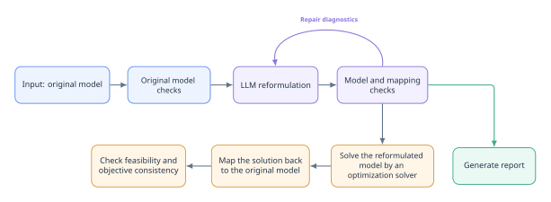

# LLM4MOR: Large Language Model for Mathematical Optimization Reformulation
## Zhao-Wei Wang, Yan-Jie Lu, Wei-Kun Chen, Yu-Hong Dai

LLM4MOR is a research framework for using large language models (LLMs) to reformulate mathematical optimization problems. Its objective is to reduce solution time by reformulation, while preserving the mathematical meaning of the original model.
The framework does not replace an optimization solver. Instead, it asks an LLM to propose an equivalent (reformulated) model and verifies the resulting solution in the original model.
Currently, modeling languages AMPL and MiniZinc are supported; other formats can be extended using this framework.

## 1. Core capabilities

- **Automated reformulation:** Applies general-purpose or problem-specific presolve, cutting-plane techniques through an LLM.
- **Iterative repair:** Returns AMPL loading errors or MiniZinc compilation errors to the LLM so that it can revise its output.
- **Solution verification:** Maps a solution of the reformulated model back to the original variables and checks feasibility and objective consistency in the original model.

## 2. Workflow



## 3. Results
We test the framework with LLM GPT-6 Astra and solver Gurobi, on [models](https://miplib.zib.de/downloads/models.zip) downloaded from MIPLIB 2017.
The results can be found in `results/results.tar.gz` in this repository.

## 4. Run with your own models

Basic command:

```bash
python llm_analyze.py <your-model-file> \
  --output-dir <folder-for-results> \
  --llm-timeout <soft-limit-for-llm-analysis> \
  --max-tokens <token-limit-for-llm-analysis> \
  --max-chars <char-limit-for-the-whole-llm-request> \
  --temperature <temperature-for-llm-analysis>
```

Use `python llm_analyze.py --help` and `python verify_solution.py --help` for all options.

### 4.0. Requirements

- Python >= 3.9.
- Access to an LLM through an OpenAI-compatible chat completions (`/chat/completions`) or responses (`/responses`) API.
- AMPL (for `.mod` models) or MiniZinc (for `.mzn` models), available on `PATH` or configured through `init.sh`.
- A MiniZinc compilation backend for checks and verification: [Gurobi](https://www.gurobi.com/) and [HiGHS](https://github.com/ERGO-Code/HiGHS) are supported. Producing a solution for the reformulated model also requires an external solver run.

Run `init.sh` with `source` so the tool paths remain in the current shell:

```bash
source init.sh [--ampl PATH] [--minizinc PATH] [--python PATH] [--gurobi DIR] [--highs PATH]
```

For example:

```bash
source init.sh \
  --ampl <ampl-path> \
  --minizinc <minizinc-path> \
  --python <python-path> \
  --gurobi <gurobi-path> \
  --highs <highs-path>
```

`--gurobi` takes the installation directory containing `bin/` or `lib/`. The script exports `LLM4MOR_AMPL`, `LLM4MOR_MINIZINC`, `LLM4MOR_PYTHON`, `LLM4MOR_GUROBI`, and `LLM4MOR_HIGHS`. Both `llm_analyze.py` and `verify_solution.py` use these variables. Arguments are optional when the tools are already available on `PATH`.

For `.mod` models, `--ampl` is sufficient for analysis and independent verification.
For `.mzn` models, `--minizinc` selects the MiniZinc executable, while a MiniZinc solver backend performs compilation checks and verification. Set `--gurobi` or `--highs` only when using the Gurobi or HiGHS backend for MiniZinc.

### 4.1. Configure your LLM API

Set the connection options as arguments:

```bash
python llm_analyze.py <your-model-file> \
  --output-dir <folder-for-results> \
  --llm-timeout <soft-limit-for-llm-analysis> \
  --max-tokens <token-limit-for-llm-analysis> \
  --max-chars <char-limit-for-the-whole-llm-request> \
  --temperature <temperature-for-llm-analysis> \
  --base-url <llm-base-url> \
  --api-key <llm-api-key> \
  --llm-model <llm-model-name>
```

Or, you can set them as environment variables, so that the script can read them automatically:

```bash
export LLM_API_KEY="your-api-key"
export LLM_BASE_URL="https://your-provider.example/v1"
export LLM_MODEL="your-model-name"
```

### 4.2. Functionalities of `llm_analyze.py`

1. Read one model file **without** an external data file.
First, we check if the model is correct.
Self-contained models receive native checks during generation; models requiring external data receive syntax-only checks.
2. Use both general-purpose and problem-specific presolve and cutting plane techniques to make the problem easier for general-purpose optimization solvers (see `prompts/common/reformulation.txt` for all reformulation prompts).
3. Directly output the reformulated model.
4. Write a standalone Python mapping script to map the solution of the reformulated model to the original model.
5. Write a report (Markdown and LaTeX), explaining the reformulation techniques it applied.

### 4.3. Analysis output and independent solution verification

`--output-dir` is the directory for generated artifacts and logs. Its default is `outputs`. Logs are saved in `<output-dir>/logs/`.

For an input named `instance.mod` or `instance.mzn`, the output directory contains:

- `instance.llm.mod` or `instance.llm.mzn`: the reformulated model.
- `instance.llm.map.py`: a standalone Python solution-mapping script, to map the solution of the reformulated model to the original model.
- `instance.llm.reply.txt`: the complete LLM conversation output.
- `instance.llm.meta.json`: original-model diagnostics, reformulated-model and mapping-script checks, repair counts, progress, errors, and timing.
- `instance.llm.report.meta.json`: report status and duration.
- `instance.llm.report.md` and `instance.llm.report.tex`: optional reports; use `--no-report` to skip them.

A self-contained AMPL example and all the outputs are stored in `example/`.
From `example/`, run analysis and verification:

```bash
bash analysis.sh
bash verify.sh
```

`analysis.sh` analyzes `example.mod` and writes the reformulated model, mapping, metadata, reports, and logs to `output/`.
After solving the reformulated model using a solver, store the solution in `output/example.sol.json`.
Then, `verify.sh` verifies the supplied reformulated solution `output/example.sol.json` by mapping it back to the original variables and checking feasibility and objective consistency; it writes `output/verification.json`.

## 5. Prompt files

Shared prompts are stored in `prompts/common/`:

| File | Purpose |
|---|---|
| `reformulation.txt` | Reformulation objective, semantic preservation, and response requirements. |
| `standalone.txt` | Self-contained model and instance-data requirements. |
| `parameterized.txt` | Validity across external instances, data-interface compatibility, defaults, and shared mapping requirements. |
| `mapping.txt` | Shared mapping input fields, output contract, and execution requirements. |
| `interface_context.txt` | Shared declaration fields, source line interpretation, and conservative recognition limits. |

Each language retains its own prompts under `prompts/ampl/` or `prompts/minizinc/`:

| File | Purpose |
|---|---|
| `system.txt` | System role and response format. |
| `reformulate_standalone.txt` | Request layout, shared requirement placeholders, language-specific rules, and interface context for a self-contained instance. |
| `reformulate_parameterized.txt` | Request layout, shared requirement placeholders, language-specific rules, and interface context for a parameterized model. |
| `mapping.txt` | Language-specific solution-mapping contract. |
| `repair.txt` | Repair request that preserves the requirements and output contract of the original task. |
| `report_md.txt` | Markdown report request, including use of saved analysis when available. |
| `report_tex.txt` | LaTeX conversion request. |
